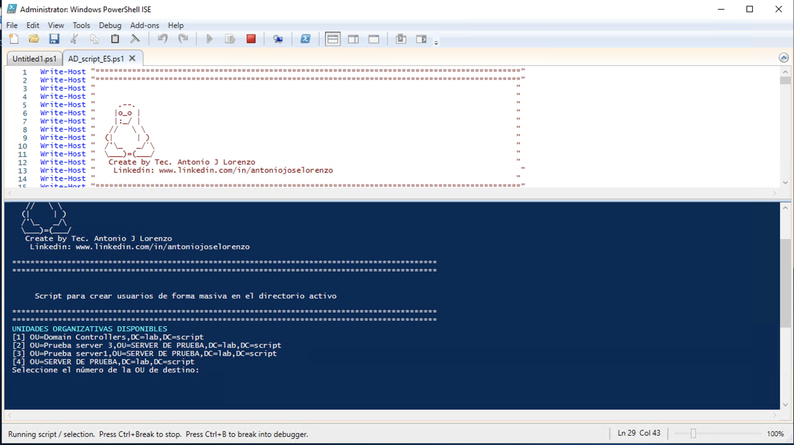
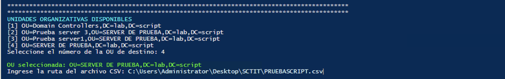
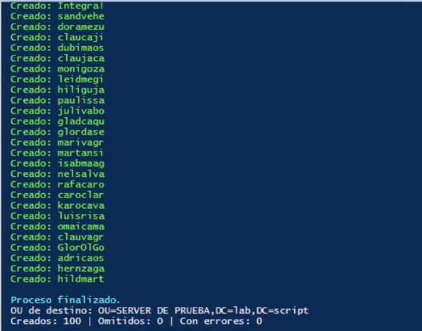
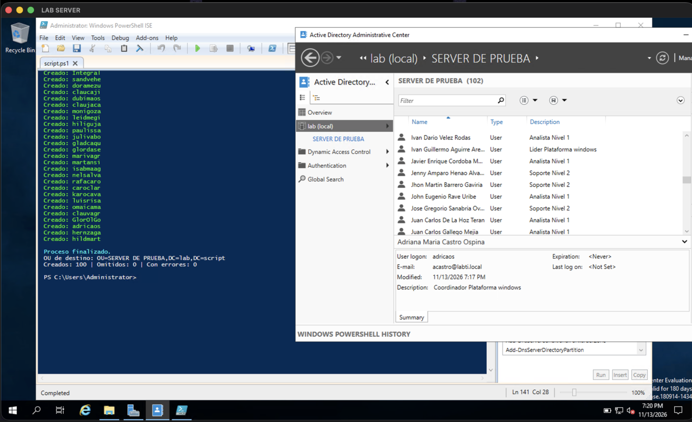
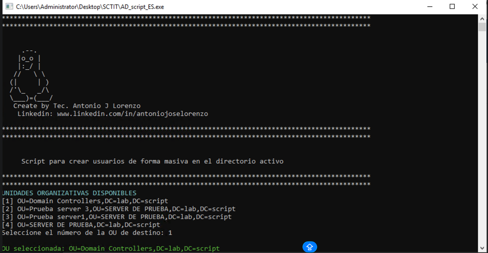

# Active Directory Bulk User Creator

I developed this project to automate user creation in Active Directory instead of creating accounts manually, using a CSV file as the source.

The workflow is straightforward: the script queries existing organizational units (OUs), lets you choose where to create the users, and processes the file's records. When it finishes, it displays how many records were created, skipped, or failed.

Available in **Spanish and English**, as both `.ps1` scripts and `.exe` executables.

## What it does

- Detects the domain and queries its existing OUs.
- Displays a numbered menu with full OU distinguished names.
- Lets you select one destination OU for the entire import.
- Reads a CSV file and validates required fields.
- Skips accounts that already exist in the domain.
- Creates enabled users and requires a password change at next logon.
- Continues processing other records if one fails.
- Displays a summary and keeps the window open until you close it using the X button.

## Test environment and requirements

I tested the scripts and executables in a **Windows Server 2019** lab. To use them in another environment, check the following requirements and run a test before performing a full import:

- Windows PowerShell 5.1 with the `ActiveDirectory` module installed.
- Domain connectivity, working DNS resolution, and access to the domain controller holding the PDC Emulator role.
- An account with permission to query Active Directory and create users in the selected OU.
- A CSV file with headers matching the selected language version.

The tool can run from a server with AD administration tools or a Windows computer with the appropriate RSAT tools. Having AD DS installed alone does not confirm all requirements. Running as a local administrator does not replace domain permissions.

The executable still requires the `ActiveDirectory` module and domain connectivity.

## Files by language

| Language | Script | Executable | CSV headers |
| --- | --- | --- | --- |
| Spanish | `AD_script_ES.ps1` | `AD_script_ES.exe` | Spanish |
| English | `AD_script_EN.ps1` | `AD_script_EN.exe` | English |

OU names and user data remain unchanged. Use the CSV format that matches the selected version.

## How to use it

### From PowerShell

Open Windows PowerShell in the script's folder and run one of these options:

```powershell
# Spanish version
.\AD_script_ES.ps1

# English version
.\AD_script_EN.ps1
```

### From the executable

Double-click `AD_script_ES.exe` or `AD_script_EN.exe`. You can also launch it from PowerShell:

```powershell
.\AD_script_EN.exe
```

### Importing users

1. Review the OUs displayed on screen.
2. Enter the number of the OU where you want to create the users.
3. Enter the CSV path, for example: `C:\Users\Admin\Desktop\Users.csv`.
4. Review creation messages, skipped accounts, and errors.
5. Check the summary and verify the users in Active Directory.
6. Close the window using the X button when finished.

**All new users in an import are created in the same OU. Running the tool creates real accounts.** For your first test, use a few records and a lab OU.

## Screenshots

These screenshots show the workflow from selecting an OU to verifying the created users and running the `.exe` file.

### 1. Selecting the organizational unit

List of existing OUs and destination selection.



### 2. Reading the CSV and creating users

File path and record processing results.



### 3. Import summary

Number of records created, skipped, and failed.



### 4. Verification in Active Directory

Users created in the selected OU.



### 5. Running the .exe file

The executable in action.



## Preparing the CSV

Save the file as **UTF-8, comma-delimited**. Enclose any value containing commas in quotation marks. In Excel or another spreadsheet application, use text formatting for account names and phone numbers to preserve their values.

### Spanish version

```csv
Cuenta,Nombre,Apellidos,Nombres,Descripcion,Oficina,Telefono,Email,Titulo,Departamento,Compania,Ciudad,Estado,Clave
```

Required fields: **`Cuenta`, `Nombre`, and `Clave`**. `Nombre` is the full name, and `Nombres` is the first name.

### English version

```csv
Account,FullName,LastName,FirstName,Description,Office,Phone,Email,Title,Department,Company,City,State,Password
```

Required fields: **`Account`, `FullName`, and `Password`**.

All other fields are optional. Keep the headers exactly as shown for each version.

### Field mapping

| English header | Spanish header | Active Directory parameter or behavior |
| --- | --- | --- |
| `Account` | `Cuenta` | `SamAccountName`; also used as the UPN prefix |
| `FullName` | `Nombre` | `Name` and `DisplayName` |
| `LastName` | `Apellidos` | `Surname` |
| `FirstName` | `Nombres` | `GivenName` |
| `Description` | `Descripcion` | `Description` |
| `Office` | `Oficina` | `Office` |
| `Phone` | `Telefono` | `OfficePhone` |
| `Email` | `Email` | `EmailAddress` |
| `Title` | `Titulo` | `Title` |
| `Department` | `Departamento` | `Department` |
| `Company` | `Compania` | `Company` |
| `City` | `Ciudad` | `City` |
| `State` | `Estado` | `State` |
| `Password` | `Clave` | `AccountPassword` |

If the file uses semicolons, change `-Delimiter ','` to `-Delimiter ';'` in the script and rebuild the executable if applicable.

## How accounts are handled

- Existing accounts are skipped; they are not moved or assigned a new password.
- The script uses existing OUs. It does not create OUs or list containers such as `CN=Users`.
- The UPN is built from the account name and the domain's DNS name. Setting the `Email` field does not create a mailbox.
- Passwords must comply with the domain's password policy.
- Two users with the same full name can cause an object naming conflict within the same OU, even if their account names differ.
- If an operation fails, review the error and the account's state before retrying: the account may have been created but left disabled or incomplete.
- The summary reflects processing results; also verify the outcome in Active Directory.

This version displays results in the console. It does not include an audit log file, automatic rollback, or a dry-run menu option.

## Building the executables

I used [PS2EXE](https://github.com/MScholtes/PS2EXE) to package the scripts as Windows executables.

Install the module on the computer where you will build them:

```powershell
Install-Module -Name ps2exe -Scope CurrentUser
```

Open the graphical interface:

```powershell
Win-PS2EXE
```

Select the source `.ps1` and output `.exe` paths. The settings used in the lab were:

| Option | Value |
| --- | --- |
| Platform | x64 |
| Threading model | STA |
| No console | Unchecked |

Repeat for each language. If you modify the script, rebuild its executable.

PS2EXE is needed for packaging, not for running the `.exe`. Packaging does not encrypt the code or include the Active Directory tools.

## Common issues

| Issue | What to check |
| --- | --- |
| The `ActiveDirectory` module does not load | Check that the AD administration tools or RSAT are installed. |
| The domain cannot be queried | Check DNS, connectivity, domain context, and access to the PDC Emulator. |
| A required column is missing | Check the header language and CSV delimiter. |
| Access is denied | Check the account's permissions on the destination OU. |
| The account already exists | Skipping it is the script's expected behavior. |
| User creation fails | Review the message, password policy, and duplicate or invalid names. |
| The window closes before the summary | Run it from an existing PowerShell window to review the error. The final keep-open loop is reached only if execution gets that far. |


## Author

**Antonio Jose Lorenzo**  
[LinkedIn](https://www.linkedin.com/in/antoniojoselorenzo)
[portfolio web](https://antoniojlorenzodev.vercel.app/)


## License


